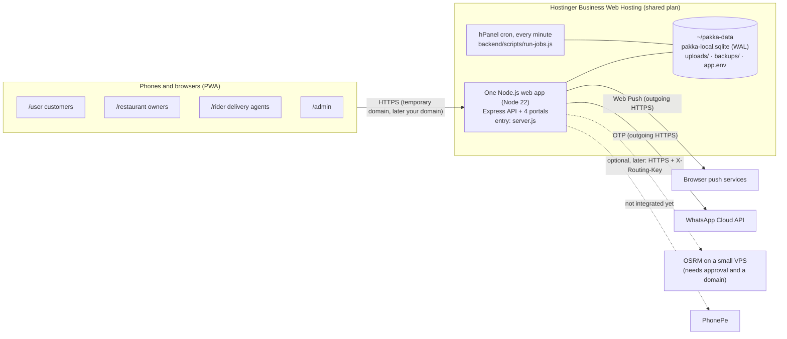

# Pakka Local on Hostinger Business Web Hosting: audit, architecture and deployment plan

Prepared 13 Nov 2026 on branch `hostinger-prep` (built on `distance-pricing`). **Nothing has been deployed, bought,
upgraded, enabled or changed in hPanel.** The hPanel pages were only read.

Labels used below: **[hPanel]** = seen in your hPanel on 13 Nov 2026 · **[docs]** = Hostinger's public documentation,
not checked in your panel · **[tested locally]** = run on this PC · **[unverified]** = must be checked on the first test deploy.

## 1. Compatibility report

### What hPanel shows [hPanel]

| Item | Value |
| --- | --- |
| Plan | Business Web Hosting, Active, expires 2030-08-31, data centre Asia (India) |
| **Account** | **The plan belongs to another Hostinger account; you have collaborator access** (hPanel banner: changes apply to their account) |
| Existing websites | 4 of 50: one WordPress site on a real domain, one PHP/HTML site and two AI Builder sites on temporary `*.hostingersite.com` domains |
| Node.js web apps | none yet |
| Memory (RAM) limit | 3,072 MB (whole plan, shared by all sites) |
| CPU limit | 100 % (Hostinger's limits page lists 2 cores for this tier [docs]) |
| Processes / I/O / IOPS | 120 processes · 20,480 KB/s · 512 IOPS |
| Disk / inodes | 0.49 GB of 50 GB · 25,932 of 600,000 |
| SSH | available, currently **inactive** (I did not enable it) |
| Cron jobs | available (PHP and Custom command) |
| Backups | Daily (Hostinger's own) |
| Temporary domains | in use by the existing sites; one answered over **HTTPS with status 200** [tested locally with curl] |

### Node.js web apps on this plan [docs]

| Topic | What Hostinger documents | Effect on Pakka Local |
| --- | --- | --- |
| Support | Business Web Hosting runs Node.js web apps (5 apps on Business/Unlimited) | One app slot is enough |
| Versions | Node 18, 20, 22, 24 | Use **22** (Node 24 crashes better-sqlite3 11.x on exit, seen locally) |
| Start / process | Entry file (`server.js`); started by Hostinger; restarted after a crash; **stopped after a period without traffic**, started again by the next request | In-app timers stop while idle → scheduled work moved to cron (code change below) |
| Background | No always-running workers; no Docker, Redis, Python services or custom ports | **OSRM cannot run here** |
| Requests | Each request stopped after 120 s | Fine (the slowest request is a file upload) |
| WebSockets | Inbound WebSockets not supported; outgoing connections allowed | Fine: Pakka Local uses ordinary HTTP polling; Web Push and WhatsApp are outgoing HTTPS calls |
| Files | App runs from `~/domains/{domain}/hbuilds/current/nodejs`; that folder is **replaced on every deployment** | Database, uploads and backups must live outside it (code guard added) |
| Deploy | GitHub/GitLab (build on push) or `.zip` upload; env vars in the panel; build and runtime logs; Restart button; failed build leaves the old version live; no one-click rollback | Use `.zip` upload of a tagged commit |
| Cron for Node | Node binary `/opt/alt/alt-nodejs22/root/bin/node`; app env vars are **not** passed to cron, use `--env-file`; UTC; 30 min max per run; command ≤ 255 characters, no `%` | Runner script added |

Sources: [Node.js overview](https://docs.hostinger.com/node.js/overview), [Node.js limits](https://www.hostinger.com/support/hostinger-node-js-limits-for-web-and-cloud-plans/),
[file structure](https://docs.hostinger.com/node.js/file-structure.md), [deployments](https://docs.hostinger.com/node.js/deployments.md),
[cron for Node.js](https://www.hostinger.com/support/how-to-run-cron-jobs-for-node-js-websites-at-hostinger/), [plan limits](https://www.hostinger.com/support/6976044-parameters-and-limits-of-hosting-plans-in-hostinger/).

### Not verified yet (check on the first test deploy)

1. A folder in your home directory outside `domains/` (e.g. `~/pakka-data`) survives redeploys. Expected, because only
   `hbuilds/` and `public_html/` are documented as replaced, but not stated by Hostinger. Step 8 below tests it.
2. better-sqlite3 (native module) installs on Hostinger's build servers. Tested only in a Debian Node 22 container.
3. Whether Hostinger's daily backup includes `~/pakka-data`. Pakka Local makes its own consistent daily copies anyway.
4. How many proxies sit in front of the app (`TRUST_PROXY`, used for per-client rate limits). Default 1.
5. Upload size accepted by Hostinger's proxy (the app accepts up to 8 MB for documents and menu photos).
6. Shortest cron interval allowed (every minute expected).
7. Whether the temporary domain of a **new web app** gets HTTPS straight away (the existing temporary domain does).

## 2. Deployment architecture



Plain text version:

```
Phones (4 portals) --HTTPS--> [Hostinger web app: Express API + /user /restaurant /rider /admin] <--> ~/pakka-data (SQLite, uploads, backups)
                                       |         ^ hPanel cron each minute: run-jobs.js (reopen, payment expiry, push, cleanup, backup)
                                       +--> Web Push services, WhatsApp API (outgoing)
                                       +..> OSRM on a VPS (optional, later)     +..> PhonePe (not integrated)
```

One app, one database, one set of logins; each portal checks the user's role on every API call (unchanged from the
current code). No separate hosting projects.

## 3. What runs on Hostinger and what does not

| Runs on the Business plan | Does not run there |
| --- | --- |
| Express API and all four portals (one app) | OSRM routing engine (needs Docker/a daemon and its own port) |
| SQLite database, uploads and backups in `~/pakka-data` | Always-on timers while the app is idle (replaced by cron) |
| Login, roles, password confirmation, rate limits, HTTPS | WebSockets (not used by Pakka Local) |
| Rider GPS sharing and live tracking (HTTP, while the rider page is open) | Background GPS with the rider page closed (browser limit, not Hostinger) |
| Sending Web Push and WhatsApp OTP (outgoing HTTPS) | Real payments (PhonePe not integrated; ordering closed on production) |
| Listed PG/college charges and the fixed GPS charge | Distance-based charges (need OSRM elsewhere; fallback charge applies if switched on) |
| Scheduled tasks every minute via cron | Map tiles: no provider chosen for production; maps show status text only |

## 4. Code changes made for Hostinger (this branch)

| Change | Why |
| --- | --- |
| `package.json`, `package-lock.json`, `server.js` at the repository root | Hostinger builds one folder and needs an entry file; building from the root keeps `frontend/` next to `backend/`. Root dependencies must equal the backend's (test enforces it) |
| `backend/scripts/run-jobs.js` and `runJobsOnce()` in `jobs.js` | One pass of every scheduled task (restaurant auto-reopen, payment expiry, campaigns, push sending, location and route-cache cleanup, backup) for the cron |
| `backupIfDue()`: daily consistent copy, keeps the newest `BACKUP_KEEP` (14) | Backups no longer depend on the app staying up for 6 hours; old copies do not fill the disk |
| Production refuses `DB_PATH`, `UPLOAD_DIR` or `BACKUP_DIR` inside the app folder | A redeploy would silently delete all data |
| `Cache-Control: no-store, private` on every API reply (public images keep their own cache) | Hostinger's CDN or any proxy must never store personal replies |
| `OSRM_API_KEY` (sent as `X-Routing-Key`); production refuses a non-HTTPS `OSRM_URL` unless it is 127.0.0.1 | A routing engine on another server must be private and encrypted (customer coordinates travel in its URLs) |
| `TRUST_PROXY` setting (default 1) | Correct client IPs for rate limits behind Hostinger's proxy/CDN |

Already in place and re-checked: production refuses simulated payments (no override); with `PAYMENT_PROVIDER=disabled`
no order can be placed and nothing is reported as paid; OTPs are never logged or returned; WhatsApp sending reports a
failure unless Meta's API accepts the message; the app logs only error messages (no request logging, no OTPs, passwords,
tokens or coordinates; coordinates are never placed in page URLs); tracking replies are `no-store`.

Tests: **136 tests, 134 passed, 2 skipped** (the real-OSRM tests, which need `OSRM_TEST_URL`); 6 new in
`backend/test/hosting.test.js`. Linux build simulation [tested locally] in a `node:22-bookworm-slim` container from a
clean copy: `npm ci --omit=dev` at the root, better-sqlite3 loads, `/healthz` and all four portals answer 200, API replies
carry `no-store`, the cron runner makes a backup, data survives replacing the app folder, a data path inside the app is refused.

## 5. Step-by-step deployment (test deployment on the temporary domain)

Do these only after the approvals in step 0. Placeholders: `USER` = the SSH username shown on hPanel → SSH Access;
`TEMPDOMAIN` = the new app's temporary domain.

0. **Approvals needed first:** (a) the plan owner agrees to host Pakka Local and customer data on their account (see
   limitations); (b) you approve enabling SSH on that account (or we use File Manager only); (c) you approve creating one
   Node.js web app. Nothing existing is touched: the app gets its own new temporary domain.
1. **Package** (on this PC): `git archive --format=zip -o pakka-local-hostinger.zip hostinger-prep` (no `.env`, no
   database, no test logins inside; checked with `unzip -l`).
2. **Secrets** (on this PC, never in git or chat): `openssl rand -base64 48` → `JWT_SECRET`; `cd backend && npm run vapid` → VAPID keys.
3. **Data folder:** hPanel → File Manager (or SSH): create `/home/USER/pakka-data` with `uploads` and `backups` inside
   (outside `domains/`, so deployments never touch it).
4. **Create the app:** hPanel → Websites → Add website → Node.js web app → upload the zip. Settings: Node **22.x**,
   root directory = the zip root, entry file `server.js`, build command empty.
5. **Environment variables** (hPanel, app settings):

   ```
   NODE_ENV=production
   APP_ENV=staging                 # test deployment; switch to production only for the real launch
   JWT_SECRET=<from step 2>
   SERVE_FRONTEND=true
   DB_PATH=/home/USER/pakka-data/pakka-local.sqlite
   UPLOAD_DIR=/home/USER/pakka-data/uploads
   BACKUP_DIR=/home/USER/pakka-data/backups
   BACKUP_KEEP=14
   PAYMENT_PROVIDER=disabled       # or, for staging only: sandbox + SANDBOX_PAYMENT_PHONES=<tester numbers>
   OTP_PROVIDER=whatsapp           # until WhatsApp is live, staging may use testcode + TEST_OTP_CODE + TEST_OTP_PHONES + ALLOW_TEST_OTP=1
   VAPID_PUBLIC_KEY=... VAPID_PRIVATE_KEY=... VAPID_SUBJECT=mailto:<your email>
   MAP_TILE_URL=none               # until a tile provider is chosen
   OSRM_URL=                       # empty: distance pricing stays off
   ```
6. **Same variables for cron:** save them as `/home/USER/pakka-data/app.env` (File Manager → permissions 600).
   Keep both copies identical when anything changes.
7. **Deploy**, read the build log, then open `https://TEMPDOMAIN/healthz` → `{"ok":true}`, and `/user/`, `/restaurant/`, `/rider/`, `/admin/`.
8. **Persistence check:** create the admin (SSH, from `~/domains/TEMPDOMAIN/hbuilds/current/nodejs`):
   `ADMIN_PHONE=+91… ADMIN_NAME="Owner" ADMIN_PASSWORD='…' /opt/alt/alt-nodejs22/root/bin/node --env-file=/home/USER/pakka-data/app.env backend/scripts/create-admin.js`.
   Then click **Redeploy** in hPanel and log in again. If the admin is gone, stop: data is not persistent.
9. **Cron** (hPanel → the app → Advanced → Cron Jobs, every minute):
   `/opt/alt/alt-nodejs22/root/bin/node --env-file=/home/USER/pakka-data/app.env /home/USER/domains/TEMPDOMAIN/hbuilds/current/nodejs/backend/scripts/run-jobs.js`
   Check "View output": one `jobs {...}` line per run; a backup appears in `pakka-data/backups` once a day.
10. **Smoke test on real phones** (only then can real GPS and push be claimed): customer login, restaurant alert, rider
    GPS sharing and the customer's live tracking, admin dashboards, a push notification on Android Chrome.
11. **Backups off the server:** weekly, download the newest file from `pakka-data/backups` (File Manager) to your PC.

Updating later: build a new zip from a tagged commit → upload → the old version stays live if the build fails →
migrations run automatically on start. Rollback = upload the previous zip (database changes are additive; take a
backup copy before each deployment).

## 6. OSRM routing

- **Cannot run on this plan** (no Docker, no daemon, no own port) [docs]. A separately hosted engine is required only if
  you want distance-based charges.
- **Recommendation for launch: keep distance pricing OFF** and use the PG/college list charges plus the fixed GPS charge,
  which run fully on Hostinger at no extra cost.
- **When you want distance pricing:** one small VPS running the same OSRM setup that was tested locally (about 144 MB RAM,
  27 MB map), behind a reverse proxy (e.g. Caddy) at `https://routing.<your-domain>` that rejects requests without the
  secret `X-Routing-Key` header. Pakka Local then gets `OSRM_URL=https://routing.<your-domain>` and `OSRM_API_KEY=<secret>`.
  This needs a domain (for the HTTPS certificate) and **your approval of the VPS cost** (section 8).
- If the engine is down, orders use the admin fallback charge (or are refused if none is set), as already built and tested.

## 7. Domain

- **Testing:** the app's free temporary `*.hostingersite.com` domain is enough; HTTPS works on the existing temporary domain.
- **Buy a domain before real users** install the app: installed PWAs, saved logins, notification permissions and push
  subscriptions all belong to the web address. Moving from the temporary domain later means every user logs in and
  enables notifications again. A domain is also needed for the OSRM HTTPS address and looks trustworthy in WhatsApp messages.
- **Connecting it later:** hPanel → the app → Connect domain; if bought at Hostinger the DNS is set automatically,
  otherwise point the domain's records to Hostinger as hPanel shows; SSL is installed automatically; DNS can take up to
  24 h, during which the temporary domain keeps working [docs]. Then set `VAPID_SUBJECT`, tell users to open the new
  address. Nothing in the database changes. **No domain is bought and no DNS is changed without your approval.**

## 8. Estimated additional costs (none approved, nothing bought)

| Item | Needed when | Estimate (check current prices before buying) |
| --- | --- | --- |
| Hosting | now | ₹0 extra: existing Business plan (owned by another account) |
| Domain | before real users | `.in` about ₹549 first year, about ₹899/year renewal; `.com` renews about ₹1,499/year (third-party listings: [cybernews](https://cybernews.com/best-domain-registrars/best-india-domain-registrars/), [zoutons](https://zoutons.com/news/hostinger-domain-price-india-2026)) |
| VPS for OSRM (KVM 1: 1 vCPU, 4 GB) | only for distance pricing | about ₹599/month on a 24-month promotional term (~₹14,376 upfront), renewing about ₹999/month ([Hostinger India VPS](https://www.hostinger.com/in/vps), [zoutons](https://zoutons.com/news/hostinger-vps-hosting-price-india-2026)) |
| WhatsApp OTP | real launch | Meta charges per authentication message; check Meta's current India rate |
| PhonePe | real launch | per-transaction fees; integration work not done |
| Map tiles | if maps are wanted | provider-dependent; none chosen |

## 9. Limitations and unresolved issues

1. **Ownership:** the hosting plan, its backups and file access belong to another person's account. Customer phone
   numbers, addresses and GPS points would sit there, and the owner could change or delete them. Get their written
   agreement, or move Pakka Local to a plan in your own account before real customers.
2. **Ordering is closed on production** until a real payment gateway (PhonePe) is integrated. The test deployment can
   use `APP_ENV=staging` with simulated payments for listed tester numbers only, clearly marked as tests.
3. WhatsApp OTP needs an approved Meta template and credentials; until then only `testcode` logins for listed testers.
4. Shared resources: 3 GB RAM and 120 processes are shared with the four existing sites; heavy traffic on them slows Pakka Local.
5. The app sleeps when idle: the first request after a quiet period is slower (cold start); scheduled tasks run at most
   one minute late via cron.
6. SQLite: exactly one app instance (Hostinger runs one). Fine for the expected load; not for multi-server scaling.
7. Distance pricing needs a VPS and a domain (section 6); stays off until approved.
8. No production map tile provider; tracking shows status text without a map.
9. The items in section 1 "Not verified yet".
10. Real Android GPS, real push delivery and real devices have **not** been tested on Hostinger; only the local
    simulations above.
11. No deployment has been made, so the first deploy is itself the test of items 1–7 in section 1.

## 10. Staging without SSH and without typing secrets (added for the first deployment)

- `SECRETS_DIR` (outside the app): on first start the app creates `jwt-secret` and `vapid.json` there (mode 600) and
  reuses them on every restart. Nobody types, pastes or sees a secret; hPanel holds only paths and switches.
- `BOOTSTRAP_ADMIN_PHONE` (+ optional `BOOTSTRAP_ADMIN_NAME`): while the database has **no admin**, one admin is created
  with a random 24-character password written only to `SECRETS_DIR/ADMIN-FIRST-LOGIN.txt` (mode 600). Read it once in
  hPanel File Manager, store it safely, delete the file, and remove the variable. It never appears in logs or the API.
- The startup log line shows the Node version, the database creation time and memory use: after a redeploy the same
  `db_created` time proves the database survived.
- Cron without SSH or an env file: `curl -s -o /dev/null https://TEMPDOMAIN/healthz` every minute keeps the app awake,
  so the in-app timers (push sending, auto-reopen, payment expiry, cleanup, backups) keep running. A first backup is
  taken one minute after each start when the last one is older than 24 h.

## 11. Staging deployment record (13 Nov 2026)

- **App:** one new Node.js Web App (1 of 5 slots) on the free temporary domain
  `https://mediumpurple-barracuda-979163.hostingersite.com` (Express preset, Node 22.x, entry `server.js`, ZIP upload;
  hPanel's GitHub/URL import is disabled for the collaborator account). Build `209cd38` (`pakka-local-hostinger-staging-2.zip`).
- **Separate storage:** `~/pakka-local-data/{db,uploads,backups,secrets}`; nothing inside any other site's folder.
- **Settings (12, no secrets):** NODE_ENV=production, APP_ENV=staging, SERVE_FRONTEND=true, DB_PATH, UPLOAD_DIR,
  BACKUP_DIR, SECRETS_DIR, BACKUP_KEEP=14, PAYMENT_PROVIDER=disabled, OTP_PROVIDER=whatsapp (not configured, so customer
  login is off), MAP_TILE_URL=none, TRUST_PROXY=1. The one-time BOOTSTRAP_ADMIN_* settings were removed after first start.
- **Cron:** `* * * * *  wget -q -O /dev/null https://mediumpurple-barracuda-979163.hostingersite.com/healthz` (keeps the app awake).
- **Verified on the host:** Node v22.23.5; database created 2026-11-13T14:11:51Z and unchanged after two redeploys
  (same files, then new files); secrets created on the server (push key served); all four portals and the API 200 over
  HTTPS; HTTP→HTTPS redirect; API replies `no-store`; customer OTP refused (WhatsApp not configured); wrong admin
  password refused; the four existing websites still answer 200.
- **Found on the host and fixed:** Hostinger can start two app processes for one app (seen after a redeploy). Push
  deliveries are now claimed with a lease so a notification is never sent twice (test: 48 sends before, 12 after).

## 12. Staging-only Email OTP (13 Nov 2026, build ff88e91)

Hostinger e-mail on this account exists only as the existing site's `@nihistudio.com` plan (free trial), so it was not
used. Codes are sent through **Brevo** (free plan, 300 emails/day; key restricted to "Transactional email" only; sender
= the verified Gmail address). Staging settings added: `EMAIL_OTP_ENABLED=1`, `EMAIL_OTP_ALLOWLIST` (one tester email
mapped to placeholder test customer +919876500001), `EMAIL_FROM`, and `BREVO_API_KEY` (pasted into hPanel by the owner;
never in git, chat or logs). Production refuses to start with `EMAIL_OTP_ENABLED=1`; WhatsApp OTP remains the real login.

Verified on the live staging site: non-approved address refused; approved address -> Brevo accepted the email -> the
tester typed the emailed code -> signed in as a customer. Staff login unchanged (wrong password refused).
To add a tester: append `,their@email=+91XXXXXXXXXX` to `EMAIL_OTP_ALLOWLIST` in hPanel and redeploy with previous files.

## 13. Staging dummy accounts and rider APK test (13 Nov 2026, build 6fb975a)

- `STAGING_TEST_ACCOUNTS=1` (refused on production) created on staging: TEST Pakka Admin (+915000000001), TEST Restaurant
  (staging) with 2 test menu items and owner login (+915000000101), TEST Rider (+915000000201, draft application),
  TEST Customer (+915000000301), delivery place "TEST Staging Hostel". +91 5xxxxxxxxx numbers are not issued to mobiles.
  Passwords and the test code are generated on the server into `pakka-local-data/secrets/TEST-ACCOUNTS.txt` and
  `test-otp-code` only. Existing accounts (first admin, email-login customer) were not touched. Cleanup:
  set `STAGING_TEST_ACCOUNTS=remove` and redeploy with previous files.
- Staging now uses `OTP_PROVIDER=testcode` (`ALLOW_TEST_OTP=1`, `TEST_OTP_PHONES` = test rider + test customer only);
  email login unchanged; payments stay disabled on staging, so customers can browse but not order there.
- Verified locally (same build, fresh database, simulated payments for the test customer only): 34/34 end-to-end checks,
  all four logins, restaurant visibility, rider application + admin approval, full order to DELIVERED.
- Rider APK in the Android 15 emulator (local copy pointing at localhost): login, offer pop-up, accept, Android location
  prompt, live GPS received by the server, status updates, pickup and delivery codes, delivered. Screenshots in
  `screenshots-rider-apk/`. Web push is not available inside the APK (in-app alerts only).

## 14. Staging simulated payments (14 Nov 2026)

Approved by the owner for staging only: `PAYMENT_PROVIDER=sandbox`, `SANDBOX_PAYMENT_PHONES=+915000000301,+919876500001`
(redeployed with the existing build). Live config reports `testPayments: true`, `ridersAvailable: true`.
Verified locally on the same build: success -> PLACED; failure -> PAYMENT_FAILED (never sent to the restaurant);
customer not on the list -> refused (NOT_A_TESTER). Production with `PAYMENT_PROVIDER=sandbox` refuses to start.
Live staging end-to-end (customer -> simulated payment -> restaurant -> rider APK -> pickup code -> delivery code ->
Delivered) completed by the owner on 14 Nov 2026 (reported; the test passwords and code are only in the private secrets folder).
To switch ordering off again: set `PAYMENT_PROVIDER=disabled` and redeploy with previous files.

## 15. Staging maps with OpenStreetMap tiles (14 Nov 2026, build a94115a)

Approved for light staging testing only: `MAP_TILE_URL=https://tile.openstreetmap.org/{z}/{x}/{y}.png` (no key, no
account, no cost). Production keeps no tile provider until one whose terms fit a commercial app is chosen.
- OSM's tile policy requires a Referer: with the site's `Referrer-Policy: no-referrer`, OSM returned a red "403 Access
  blocked" tile. The map layer now sends only the site origin (`strict-origin-when-cross-origin`); page paths and order
  codes are never sent. "© OpenStreetMap contributors" is shown on every map.
- Verified locally (Chrome, 390 px and 1280 px): customer order-tracking map and admin live map load real tiles (0
  blocked), show the attribution, and the rider marker moves on each new GPS point (12/12 checks; screenshots in
  `screenshots-maps/`). Live staging: CSP allows tile.openstreetmap.org, OSM serves real tiles to the staging origin.
- The rider app has no in-app map by design (navigation opens Google Maps).
- Limits: OSM's public servers are volunteer-run and only for light use: no heavy traffic, no bulk downloading;
  they can block an app at any time. Not for production.
